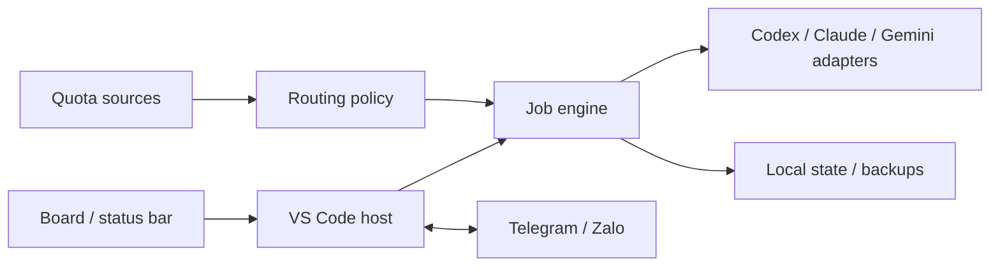

# RelayCrew

**English** · [Tiếng Việt](README.vi.md)

**Coordinate your AI coding team from VS Code.**

RelayCrew connects installed Codex, Claude Code and Gemini CLIs into a small, observable workflow. Assign Dev, Audit, Repair and Lead roles, inspect what each agent receives and returns, schedule work, and pause the team whenever you need to.

**Status: early local-first release.** Core behavior is tested with fake CLIs/transports. Provider accounts, model availability and public messaging endpoints require your own setup. No hosted RelayCrew account or shared backend is required.

## Features

**Markdown starter pack (0.9.4):** [role guides, workflows and task/acceptance templates](examples/README.md), bundled in the VSIX. Open **Setup → Input and response templates → Markdown examples**, copy/edit a guide, then import it.


See the bilingual [operations guide](docs/OPERATIONS.md) for task acceptance, public agent conversations, timeline planning and Local/Cloud connections.


- **CLI onboarding:** visible Install CLI, Sign in and Check connection controls on every saved account. Install/login run in dedicated terminals; authentication is completed by you.
- **Real accounts and workflows:** add/edit profiles inline, detect CLI paths, assign team roles, open isolated login terminals, and run a real read-only trial. Import a Markdown guide with optional account/model configuration. See [quick start](docs/QUICKSTART.md) and the [workflow example](docs/workflow.example.md).
- **Optional model IDs and usage controls:** automatic CLI catalog/provider flagship aliases, optional custom pins, reasoning levels and per-account quota ceilings. See [models and templates](docs/MODELS-AND-TEMPLATES.md).
- **Editable roles and prompts:** rename roles, attach a role-specific Markdown guide, edit input/output templates and preview locally. Pencil buttons on role cards and flow nodes open the editor directly; task snapshots retain names/guides.
- **Attachments & clipboard:** pick/drop PNG/JPEG or UTF-8 text/code, paste clipboard images, and copy answers/reports. Draft snapshots survive reloads; limits and provider transport are documented in [console usage](docs/CONSOLE.md).
- **Chat or team task:** chat uses one read-only account, while team tasks run the configured pipeline. Enter sends, Shift+Enter adds a line; Ctrl+Enter and a configurable send preference are supported. Greetings avoid unnecessary audits. See [console usage](docs/CONSOLE.md).
- **Task mission board:** queue multiple tasks, track recorded phase progress and separate owner Definition of Done, inspect flow diagrams, assignments and saved documents.
- **Operational overview:** decisions/failures to resolve, current work, serial queue, missing quota observations and next scheduled window.
- **Local / Cloud / third party:** native CLI remains primary; compatible HTTP endpoints support read-only streaming chat/review with explicit context, catalog discovery and SecretStorage API keys. Ollama/LM Studio presets are included.
- **English / Vietnamese:** change the live UI language in Setup; Command Palette and Settings labels follow the VS Code display language.
- **Inline configuration:** theme-aware forms for accounts, team/model choices, routing, Markdown guides, quota, account switching and messaging, with Save actions and errors in the board. Common configuration commands open the same board instead of popup wizards.
- **Projects board:** group tasks by source project, create an optional Git worktree per new task, see the active account, and prepare Codex desktop chats for task folders.
- **Daily quota tasklist:** inline budget/target setup, account eligibility explanations, next dispatch preview, reorderable unstarted tasks, owner decisions and bounded independent maintenance.
- **Primary manager:** an accent card, selected role button and final flow node identify the final decision maker. Add up to four supporting coordinators, including separate accounts of the same provider.
- **Small visual flows:** Dev → Audit → Lead, with an optional Repair stage. Choose an account profile and model/reasoning override for each role.
- **Live supervision:** actual running profile/model, public CLI events, prompts, responses, audit findings and lead decisions. Private model reasoning is not exposed.
- **Limits at a glance:** a persistent status-bar item with account usage, freshness, reset times and multiple quota windows. Click it to inspect accounts, update a snapshot or switch a task.
- **Explicit account switching:** queued and waiting tasks can be reassigned. Running tasks are paused first; a manual task selection is pinned so automatic rotation does not override it.
- **Quota-aware routing:** selected profiles, compatible-account fallback or an explicit round-robin pool. Unknown/stale quota is not treated as free capacity for automatic rotation.
- **Schedule planner:** inline one-time/recurring tasks and reminders, Timeline / Board / Table views, estimated windows, timezones and per-occurrence acceptance snapshots while VS Code is open.
- **Two-way messaging:** Telegram long polling and signed Zalo OA webhooks. Ask questions, submit tasks, inspect status, cancel work and answer an agent's clarification request.
- **Useful backlog mode:** dispatch real backlog items within a time/run budget and available quota. No dummy requests to burn tokens.
- **Persistence and backups:** durable queue/pause state, previous JSON state versions, local reports and source snapshots before editable steps.

## Quick start

### Requirements

- VS Code **1.96 or later**, on a local trusted workspace.
- The CLI(s) assigned to your flow, installed and authenticated separately. For HTTP-only read-only chat, a running compatible endpoint replaces this requirement. You do not need all three providers if your flow uses fewer.
- A Git working directory for the default source backup before editable work.
- Node.js **22** and npm when building from source.

### Install a local VSIX

Download the VSIX from [RelayCrew 0.9.4 prerelease](https://github.com/HiTranquility/RelayCrew/releases/tag/v0.9.4), or build a package from this repository:

```sh
git clone https://github.com/HiTranquility/RelayCrew.git
cd RelayCrew
npm ci
npm run package
code --install-extension relaycrew-0.9.4.vsix
```

You can also use **Extensions → … → Install from VSIX…**. This repository does not automatically publish to the VS Code Marketplace.

### Repository layout

```text
RelayCrew/
├── src/
│   ├── extension.ts        # Stable VS Code entry point
│   ├── host/               # Activation, settings, commands and timers
│   ├── core/               # Task engine, routing rules and shared types
│   ├── adapters/
│   │   ├── cli/            # Codex, Claude and Gemini subprocesses
│   │   ├── quota/          # Usage observations and summaries
│   │   └── messaging/      # Two-way Telegram and Zalo transports
│   ├── storage/            # Atomic state and source backups
│   └── ui/                 # Assignment board, flow setup and dialogs
├── test/                   # Automated tests and VS Code host smoke test
├── scripts/                # Build, packaging, preview and smoke helpers
├── docs/                   # Architecture, operations and UI previews
├── media/                  # Extension assets
├── releases/               # Versioned VSIX/source archives and release notes
└── .github/workflows/      # Windows/Linux CI
```

Build output goes into `dist/`; local packages are named `relaycrew-<version>.vsix`. Dependencies, build output and root-level VSIX files are excluded from Git; explicitly archived packages in `releases/` are retained. Personal configuration, credentials and runtime data belong in VS Code settings/storage, outside this source tree. See [architecture](docs/ARCHITECTURE.md) and [contributing](CONTRIBUTING.md) before extending a module.

Versions **0.1.0, 0.2.0, 0.3.0, 0.3.1, 0.4.0, 0.5.0, 0.6.0, 0.7.0, 0.8.0, 0.9.4 and 0.9.4** have separate [release archives](releases/README.md), source provenance, notes and SHA-256 checksums. See the [changelog](CHANGELOG.md) for changes. Run `npm run releases:verify` to check retained assets. The [release workflow](.github/workflows/release.yml) publishes a GitHub prerelease when a matching source tag is pushed; preparing these files does not publish anything by itself.

### Configure your first team

1. Open a project folder and the **RelayCrew** sidebar.
2. Open **Accounts & quota → Add account** and save the inline form. Set executable paths if needed and clear account labels. Automatic flagship/recommended selection requires no model ID; an ID/alias is an optional advanced override.
3. Open **RelayCrew: Setup Team Flow**, choose a three- or four-stage flow, select the **Primary manager** and optional supporting coordinators. Empty model/reasoning overrides inherit the profile configuration.
4. Open **RelayCrew: Open Assignment Board** and submit a small task with acceptance criteria.
5. Editable work is **off by default**. Enable **Allow Edits** when ready; Dev/Repair use provider-native edit permission modes. Audit/Lead stay in read-only/plan mode.
6. Use **Pause immediately**, **Resume queue**, or **Cancel task** from the board/sidebar. Reports and account details are available without opening raw CLI logs.

Tasks automatically advance through their configured stages while the queue is not paused. Pausing stops the active CLI tree, preserves existing file changes, and leaves the step resumable. Resuming may retry a partially completed step; the agent is instructed to inspect existing changes first.

## Language and configuration

Open **Assignment board → Setup** for language, profiles, flow, messaging, routing, timeouts, quota thresholds, backup limits and execution toggles. Numeric fields are validated before saving. **All VS Code settings** exposes advanced options; raw JSON is optional.

`aiTeam.language` accepts `auto` (default), `en` or `vi`. The board, flow, dialogs, status summaries and local reports change immediately. VS Code contributes Command Palette/Settings labels through `package.nls.json` and `package.nls.vi.json`, so those labels follow the editor’s display language. Prompts, agent responses, model IDs and account labels remain exactly as supplied. Provider diagnostics can remain in their original language.

For two accounts of the same provider, use different profile IDs and authenticate isolated CLI environments. The inline account editor sets config-directory paths and stores secret environment variables through **Store profile secret**. Other environment settings are available in **Advanced VS Code settings**. Merely giving the same logged-in CLI two different labels does not switch accounts. Provider-specific authentication and exact model IDs remain the owner’s responsibility.

## Management and daily quota

Choose the final decision maker in **Setup Team Flow → Primary manager**. Supporting coordinators run read-only review steps and report to that manager. They cannot mark a task approved. The primary is pinned: automatic fallback and round robin cannot silently transfer final authority. To replace it, explicitly switch the Lead account on a paused task. Existing tasks retain their original team snapshot.

In **Daily quota tasklist**:

1. Add useful tasks and assign an account to each.
2. Start/configure the plan, select allowed accounts, a quota target (1–100%) and a maximum of 1–200 tasks. Uncheck any account/model you want to preserve.
3. Refresh quota sources. Every daily step requires a fresh available observation; unknown usage pauses dispatch. Exclusions also apply to managers/coordinators. An excluded or exhausted primary leaves final approval waiting.
4. Leave **Independent maintenance** enabled for bounded code review, UI/UX, hotkey, conventions and CI/CD reviews. Each category runs at most once per account per day; it does not loop just to consume tokens. If useful work ends, the plan can stop below the quota target.
5. Important decisions should produce the agent’s `needs_owner` envelope. The extension records the question and pauses that task; reply through the board or a configured messaging channel. Independent maintenance must not implement a blocked decision. Recognizing semantic importance depends on the agent following the protocol.

The plan stops at midnight in its configured timezone or its dispatch budget. The final budgeted task can finish; midnight pauses active daily work. Provider quota windows keep their own actual reset times—they are not assumed to reset daily. A new day requires starting a plan again. Earlier-day/other-project tasks are not automatically replayed. The start wizard can explicitly carry selected unfinished tasks from the same project/included accounts into the new day; these count against the new budget and retain their owner questions. The budget counts tasks, including their review stages; it is not an exact token or currency cap. A request already in flight may cross the configured usage target.

Daily tasks default to read-only. New editable daily tasks require **both** the daily edit toggle and global **Allow Edits**. Turning edits off pauses active daily work; turning them back on does not grant write permission to previously read-only tasks. Failed/interrupted work requires review before further work for that account. Use **Pause immediately** to stop all work, or **Stop daily plan** to pause only daily dispatch. Restart the plan after stopping to continue its unfinished tasks.

## Projects and Codex desktop

The **Projects** tab groups durable task history by exact working folder and shows open workspace roots even before they have tasks. Nested worktrees remain distinct. It displays active profiles/models, task status, reports and a **New task in project** button. Multi-root workspaces remain within one sequential RelayCrew runner.

**Open project chat in Codex** uses the [documented desktop deep link](https://learn.chatgpt.com/docs/reference/commands) with an encoded absolute `path`. The desktop app must be installed. The link prepares a new chat for the folder; it does not submit prompts, switch the desktop account, synchronize RelayCrew transcripts, or create sidebar Projects automatically. Enable **Create a separate Git worktree for each new task** (`aiTeam.isolateTasks`) to create a branch/checkout before any provider call. It starts from committed HEAD and requires a clean source checkout; RelayCrew does not commit or stash owner changes. Task folders live in workspace extension storage outside the source repo. All stages of the task share its checkout; the board groups it under the original project and shows the task branch/folder. Results are never merged or removed automatically. Preserve extension storage while these checkouts are needed. Nested projects retain their relative path; submodules/dependencies may need separate setup.

Enable **Prepare a Codex desktop chat for each new task** (`aiTeam.openTasksInCodex`) to open a workspace chat once when a new task starts. Both options default off and are captured for new tasks; existing tasks keep their mode. RelayCrew continues its own CLI workflow. No public API for automatically creating desktop sidebar project groups was identified, so that part remains unimplemented. See [the integration boundary](docs/PROJECTS.md).

## Account profiles

Profiles are personal **VS Code User Settings**, not repository configuration. A profile identifies a CLI environment/account setup; it is not an automatically verified email address or a browser login switch.

```json
{
  "aiTeam.profiles": [
    {
      "id": "codex-main",
      "label": "Codex · Work account",
      "provider": "codex",
      "executable": "codex",
      "model": "",
      "effort": "medium",
      "env": {},
      "secretEnv": []
    },
    {
      "id": "claude-main",
      "label": "Claude · Reviewer",
      "provider": "claude",
      "executable": "claude",
      "model": "",
      "effort": "medium",
      "env": {},
      "secretEnv": []
    },
    {
      "id": "gemini-main",
      "label": "Gemini · Worker",
      "provider": "gemini",
      "executable": "gemini",
      "model": "",
      "env": {},
      "secretEnv": ["GEMINI_API_KEY"]
    }
  ]
}
```

Use **RelayCrew: Store Profile Secret** for entries in `secretEnv`. Values are stored through VS Code SecretStorage and supplied to that profile's subprocess. Keep tokens out of `env`, prompts, issues and committed settings. Complete login/account-directory isolation using the provider CLI's supported configuration; RelayCrew does not copy auth files.

The public product name is RelayCrew. Existing `aiTeam.*` settings/command IDs and the extension identity `local-ai-team.ai-team-workbench` are intentionally retained for local upgrade compatibility. The publisher is a development placeholder, not a claimed Marketplace publisher.

## Quota configuration

Quota data currently comes from manual snapshots or a local integration-written JSON file. **RelayCrew does not automatically read subscription limits from provider accounts.** File polling defaults to 30 seconds and can be changed with `aiTeam.quotaRefreshSeconds`; it runs only while the extension host is active.

Add an absolute `quotaFile` path to a profile, or use **RelayCrew: Update Quota**. A snapshot can represent one or several quota windows:

```json
{
  "source": "your-supported-provider-integration",
  "observedAt": "2026-10-16T09:00:00Z",
  "windows": [
    { "id": "session", "label": "5-hour", "usedPercent": 45, "resetsAt": "2026-10-16T12:00:00Z" },
    { "id": "weekly", "label": "Weekly", "usedPercent": 92, "resetsAt": "2026-10-19T00:00:00Z" }
  ]
}
```

A single-window snapshot can use top-level `usedPercent`. The effective percentage is the most constrained reported window. Optional `remainingTokens` and `limitTokens` must come from the data source; percentages are never converted into invented token counts. Observations older than five minutes, or crossing a reported reset, require refreshing.

| Setting | Default | Purpose |
|---|---|---|
| `aiTeam.quotaRefreshSeconds` | `30` | File/integration polling cadence |
| `aiTeam.quotaThreshold` | `95` | Stop/skip accounts at or above this usage percentage |
| `aiTeam.autoSwitch` | `false` | Before a step, fall back to a fresh available compatible profile |
| `aiTeam.routingMode` | `selected` | Use a selected profile or explicit `roundRobin` pool |
| `aiTeam.rotationPools` | Empty pools | Allowed profile IDs per role |
| `aiTeam.resumeAfterQuota` | `false` | Resume quota-paused work when fresh observations confirm capacity |
| `aiTeam.resumeProviderLimited` | `false` | Also allow retrying a provider-limited step that may have partially edited files |

Use **RelayCrew: Configure Rotation / Routing** to select pools through the UI. A manual account switch on a particular task pins that role to the selected profile; completed steps retain their original account/model history. Switching an account means starting a later subprocess with another configured profile, not rewriting credentials beneath a running CLI.

## Messaging, schedules and backups

- [Two-way Telegram / Zalo setup](docs/CONNECTIONS.md): credentials, sender allowlists, webhook configuration, supported chat commands and delivery behavior.
- [Operations and recovery](docs/OPERATIONS.md): continuous dispatch, immediate pause, partial retries, quota budgets, snapshot coverage and recovery.
- [Architecture](docs/ARCHITECTURE.md): module boundaries, configuration ownership, quota adapters and future scaling.
- [Roadmap](docs/ROADMAP.md): planned work that is not implemented yet.

Telegram needs a dedicated bot token and allowed chat/user IDs. Zalo uses Official Account OpenAPI and requires your own public HTTPS forwarding to the local signed webhook listener. A messaging connection is not active until you configure it.

Schedules use your system timezone by default; `aiTeam.timezone` can override it with an IANA timezone. A saved schedule retains its timezone. VS Code must remain open. Missed automatic task runs older than 60 seconds are skipped instead of executing a backlog of old scheduled work.

State and messaging history are stored per workspace, with previous JSON versions and recovery handling. Source snapshots default to Git tracked/non-ignored files before editable Dev/Repair steps. Ignored runtime data, live databases, symlinks and submodules need separate handling. These are local recovery copies, not an off-device or transaction-consistent database backup.

## Architecture



Each installation runs locally. More GitHub stars do not require a shared backend: credentials, execution and workspace state stay on each user's machine. The code keeps quota observations, routing decisions, job transitions, CLI transport and UI rendering separate so provider support can evolve independently.

## Current limits

- This is an early release; it has not been validated against every CLI version, model, operating system or subscription plan.
- No automatic provider sign-in, verified account identity, native subscription-quota discovery, token-price calculator, or global model ranking.
- No execution while VS Code is closed, cross-machine scheduler, arbitrary workflow graph, concurrent agents/worktree execution, or automatic GitHub issue publication.
- One runner per workspace identity. Different workspaces/profiles/machines can still target the same checkout/account; avoid overlapping writers and Telegram pollers.
- Private prompts, transcripts and backups stay in local storage but are sensitive. Do not attach raw workspace storage or auth data to GitHub issues.
- Provider-native permission modes still apply. RelayCrew is not an independent sandbox, and pause/cancel does not undo completed commands.

## Development

```sh
npm ci
npm run check
npm test
npm run build
npm run preview
npm run package
```

F5 launches the Extension Development Host. Optional native smoke testing accepts your installed VS Code executable path:

```sh
node scripts/smoke.mjs /absolute/path/to/your/code-executable
```

Tests use fake CLIs/transports and a local signed webhook; they do not require paid provider calls or real messaging credentials. GitHub Actions is configured to check and package on Windows and Linux. See [validation](docs/VALIDATION.md) for the checks performed and remaining live integration tests. Optional browser QA: install Playwright independently, then run `npm run test:ui` after generating previews; `RELAYCREW_PLAYWRIGHT_MODULE` and `RELAYCREW_BROWSER_EXECUTABLE` accept local tool paths.

See [CONTRIBUTING.md](CONTRIBUTING.md) for issue reports and contribution boundaries. Maintainers should review changes, run CI and create releases deliberately; no included workflow publishes to the Marketplace or creates external messages.

## License

[MIT](LICENSE) · Copyright (c) 2026 HiTranquility.
