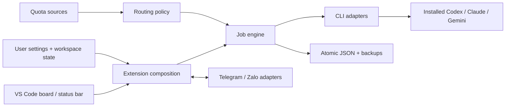

# RelayCrew architecture

## Live console boundary (0.5)

`core/console-input.ts` parses bounded application commands, never shell commands. `host/console-controller.ts` validates workspace/session scope, persists task/reply IDs, checks owner-question versions, and calls the existing job factory and engine. Pause/resume set explicit states.

`ui/live-console.ts` escapes public events; `ui/console-client.ts` patches session content while preserving the composer. The CLI runner supplies redacted public output. Streaming refreshes at most roughly once per 750 ms; other state/configuration updates patch board panels. Language changes rebuild with retained webview state. A ready handshake delivers composer requests after initial load. No PTY or closed-editor daemon is introduced. See [console behavior](CONSOLE.md).

RelayCrew runs on each user's machine. GitHub stars/downloads increase the number of independent installations, not traffic to a shared RelayCrew backend. The extension does not proxy AI credentials through a project server.

## Source boundaries

`src/extension.ts` is the stable VS Code entry point. `src/host/extension-host.ts` composes the application: it owns activation, configuration, commands, lifecycle and periodic dispatch. Keep orchestration rules in `src/core/`, integration details in `src/adapters/`, durable state and source snapshots in `src/storage/`, and rendering/dialogs in `src/ui/`.

The dependency direction is toward `core`: the engine and its types do not import the host, UI, storage or adapters. In particular, backlog contracts live in `core/domain.ts`, so dispatch policy can run without loading a view. The host supplies the engine's execution/persistence hooks and connects UI events to actions.

| Change | Start here |
|---|---|
| Task lifecycle, role routing, validation, backlog policy | `src/core/` |
| CLI flags, output parsing, cancellation, secret redaction | `src/adapters/cli/` |
| A new supported quota source | `src/adapters/quota/` |
| Telegram/Zalo inbound and outbound transport | `src/adapters/messaging/` |
| State persistence or source snapshot behavior | `src/storage/` |
| Board, flow controls or connection dialogs | `src/ui/` |
| VS Code commands, configuration or lifecycle wiring | `src/host/` |

This remains one extension package. Separate services or a monorepo are not required for the current local execution model. Folder names do not imply that closed-editor scheduling, parallel agents or live provider quota discovery have been implemented.

## Configuration boundaries

| Data | Location | Share with repository? |
|---|---|---|
| CLI executables, personal account profiles, rotation pool, edit/retry controls | VS Code User Settings (`application` scope) | No |
| Task flow, role/model overrides, task pins, queue, pause, schedules and backlog | Per-workspace extension storage | No |
| Provider API keys, bot tokens, OA credentials | VS Code SecretStorage | No |
| Quota snapshots | Manual input or absolute local `quotaFile`; normalized into workspace state | No |
| Tests, example configuration, architecture and CI | Repository | Yes, fake values only |

The current task snapshot freezes role assignments and model overrides. Explicit task switches pin the new profile for that role, bypassing automatic rotation for that role on that task. Switching a running task first pauses and terminates its CLI process; it does not swap credentials beneath a live process. Completed steps retain their actual profile/model history. A resumed step may already contain partial edits and must inspect existing changes.

## Quota observations

`QuotaSource` reads data; `QuotaService` normalizes it; routing decides whether to run. The default source reads a bounded local JSON file. Manual snapshots remain supported. No undocumented subscription endpoint is queried.

An observation can include multiple windows, for example a 5-hour window and a weekly window. The effective percentage is the maximum reported percentage, so a weekly limit cannot be hidden by an available short window. Missing/invalid/stale observations remain unknown. If any reported window crosses its reset time without a new observation, the observation needs refreshing.

The status bar uses the profile actually recorded on the running step, including round-robin and task pins. When idle, it summarizes the maximum known usage across profiles and counts unknown profiles. Clicking it opens account inspection, manual quota update and task-switch actions.

The file source can later be replaced/extended with an official provider integration through the same interface. Such an adapter needs documented authentication, freshness, cancellation, rate-limit behavior and tests. A 5-hour quota, weekly quota, context window and API billing budget are distinct concepts; the UI must not invent a conversion between them.

## Concurrency and persistence

One job runs per workspace runner. Account credentials are supplied to a new subprocess for each step. Workspace/PID locks prevent the common duplicate-window case; they do not coordinate machines or different VS Code profiles/workspace identities. Keep one active workspace per checkout and one poller per Telegram bot.

State is written atomically with previous-value backups. Recovery of older state pauses dispatch rather than replaying potentially completed work. Source snapshots run before editable steps; Git-ignored data, live databases and submodules require explicit separate handling. See [operations](OPERATIONS.md).

This is an early release, not a hosted multi-tenant service. Cross-workspace account leases, concurrent worktree execution, durable database migrations and a daemon for closed-editor execution remain future work. A shared service should only be introduced for a concrete shared-state requirement, with its own authenticated protocol and ownership rules.

## Open-source release practices

- Keep public configuration portable; never ship a developer's absolute home path or auth material as defaults.
- Preserve command/settings/extension identities when rebranding; migrate before changing persisted identifiers.
- Test on Windows and Linux, and test provider capabilities with fixtures rather than live paid accounts in CI.
- Publish artifacts only from reviewed releases. The included CI builds artifacts and does not publish Marketplace releases or message users.

VS Code references: [configuration scopes](https://code.visualstudio.com/api/references/contribution-points#contributes.configuration), [StatusBarItem](https://code.visualstudio.com/api/references/vscode-api#StatusBarItem).

## 0.4 presentation and task policy

`core/i18n.ts` translates presentation using English source keys and Vietnamese entries; stored status codes, prompts and model/profile IDs remain stable. Package NLS labels follow the VS Code display locale independently of the runtime preference. `ui/setup-panel.ts` emits a numeric allowlist validated in `core/settings.ts`; account setup uses native dialogs and SecretStorage.

Management snapshots pin one primary account per task. Supporting coordinator steps carry their own account IDs and read-only roles; only the non-coordinator Lead step can finalize. Daily policy is pure in `core/daily-plan.ts`; `host/daily-controller.ts` supplies native dialogs and dispatch. Exclusions and fresh-quota gates apply before every daily call. Decision records persist with state. Maintenance is finite per account/category/day.

`core/projects.ts` derives project groups from persisted source/execution folders. `storage/worktrees.ts` prepares retained, validated Git checkouts before provider execution through the engine hook. New tasks capture isolation/desktop-open settings. The desktop boundary is a documented deep link, not a database connection or two-way app-server session; see [Projects](PROJECTS.md).

## Real CLI setup, workflow documents and attachments (0.6)

`local-cli.ts` discovers executables and checks versions without model calls. Native connection setup and inline Accounts forms save validated profiles. Role assignment changes future work; session switching retains completed account history. Login terminals use executable/argument arrays and per-profile environment rather than interpolated shell commands. Users complete authentication. Read-only connection trials run the normal engine with three bounded stages and no Repair.

`core/workflow.ts` parses UTF-8 Markdown and an optional single version-1 relaycrew JSON block. It validates topology, existing profile references, model overrides and manager authority; it cannot import executable paths or secrets. The host previews and applies the configuration. New jobs snapshot guide text/hash, including daily work.

`storage/attachments.ts` persists bounded payloads and metadata under workspace extension storage. Webviews send bytes only for explicit picker/drop/paste actions, then retain metadata IDs. The controller resolves IDs before queueing, deduplicates submissions and enforces cumulative task limits. Each CLI invocation verifies hashes and prepares only the selected run's image files in its disposable directory. Codex gets native image flags; Claude/Gemini use documented scoped directory flags and explicit image-read tool instructions. Text is JSON evidence on stdin. No image data enters persisted webview state or reports. Caches are retained with a 256 MB cap; manual backups must include attachment storage.

## 0.9 observation, planning and transport boundaries

`core/task-insights.ts` computes recorded-phase progress independently from owner acceptance, and selects public handoffs/replies without replaying completed stream fragments. `ui/task-workbench.ts` renders escaped readable responses, task flows and context; it never runs provider HTML/Markdown. `core/schedule-form.ts` validates inline schedules and bounded timeline projections. The host snapshots each occurrence's criteria and continues using the durable scheduler claim mechanism.

`adapters/runtime.ts` dispatches existing CLI profiles by default and compatible HTTP profiles explicitly. `adapters/http/compatible.ts` handles bounded catalog/JSON/SSE responses, UTF-8 boundaries, cancellation, quota errors and secret masking. It sends only explicit prompts/attachments and has no local repository tools. Local/Cloud is explicit endpoint metadata, not proof of inference location. Compatible API credentials are separate from CLI login and held in SecretStorage. Automatic fallback requires the same location, transport and endpoint; explicit owner pools remain possible.

The engine still executes serially. Multiple tasks can wait independently for owner decisions or quota. Phase counts reserve future audit/manager work, include repair expansion and do not provide a code percentage/ETA. Acceptance changes persist into state/reports; manager approval and owner checkmarks have different meanings. Scheduling windows are estimates, not resource reservations. See [operations](OPERATIONS.md).
