# RelayCrew 1.1 — what actually runs

Start with **Setup**, add or check your connections, assign roles, and optionally attach Markdown instructions. Open the composer, select **Team task**, choose folders and permissions, and add a Definition of Done. Send opens an inline review. **Confirm and queue task** is the action that queues work. Reviewing alone never calls a model. A changed task or execution configuration needs a fresh review.

```mermaid
flowchart LR
  Setup[Accounts and roles] --> Draft[Task, folders and acceptance]
  Draft --> Review[Review saved plan and limits]
  Review --> Queue[Confirm and queue]
  Queue --> Dev[Dev or dispatcher]
  Dev --> Audit[Audit or planner]
  Audit --> Workers[Bounded workers when assigned]
  Workers --> Recheck[Repair audit when required]
  Recheck --> Managers[Coordinators and manager decision]
  Managers --> Owner[Owner verifies acceptance]
```

Workers, repair rechecks and supporting managers depend on the saved workflow. They are not unconditional extra calls. A normal greeting or one-account Chat does not trigger the coding pipeline. Markdown provides instructions, not permissions.

## Observation

Tasks, Live and Agent Map share the recorded run status, next required action, active account, real child count, observed file changes and latest public-event time. Expand the status strip for the folder, attempts and latest command. No event is not evidence of a hung process. Recorded phase progress is not an estimate of code completion.

Double-click an agent to view assignment, result and public activity. Pause view freezes observation only. Public commands and progress are shown when the connection supplies them; private reasoning is excluded. Files mentioned by a model are separate from observed Git changes. Concurrent user edits can appear in observations, and native-child authorship of individual file changes is not inferred.

## Capability matrix

| Connection | Login / identity | Quota | Repository tools | Native child observation |
|---|---|---|---|---|
| Codex CLI | Safe native account reads where supported | Native quota windows where available; stale/unknown readings stay unknown | CLI tools within selected permissions | Opt-in bounded read-only Codex runs; only actually reported children |
| Claude CLI | Native auth status where supported; isolated configuration folders supported | Native limits are not automatically inferred from auth; manual/file observations supported | CLI tools within selected permissions | Workbench stages visible; separate native-child telemetry not promised |
| Antigravity CLI | Native shared Google login; a profile email is not a verified independent login | Native usage can describe the shared CLI login, not separate profile quotas | CLI tools supported by the installed CLI and selected policy | Workbench stages visible; separate native-child telemetry not promised |
| Legacy Gemini CLI | Native configuration; identity may be unverified | Manual/file observations | CLI tools within selected permissions | Workbench stages visible |
| Compatible local/cloud HTTP endpoint | Endpoint catalog check; API key held in SecretStorage | Manual/file observations; API billing is separate from subscription quota | Read-only attached context; no repository tools | No native repository subagents |

Automatic model selection follows available catalogs or supported aliases. Custom IDs are optional. A successful connection/catalog check does not prove that a paid generation will succeed. Readiness checks do not spend model tokens.

## Execution and recovery

- One task runs at a time per workspace runner. Multiple Live tabs observe independent sessions; they do not create concurrent worktree execution. Separate workspaces do not yet share an account lease.
- Closing an observer does not stop the CLI. Scheduling requires the extension host and workspace to remain open. There is no background daemon for a closed editor.
- After an interrupted host, the queue and automatic daily/backlog dispatch pause. Completed steps, existing files, review rounds and provider-limit retry counts are preserved. Inspect changes, explicitly queue the unfinished step, then resume the queue when ready.
- Default code/review budget is three rounds; new tasks can configure it. Each provider-limited step has at most three retries. Account rotation cannot reset either budget.
- Automatic fallback requires an independent eligible login and fresh available quota. Unknown quota is not free capacity. Reviewer/manager/daily seats require explicit switching. A quota ceiling gates the next dispatch; it cannot precisely stop a paid request already in flight.

## Saved data

Secrets stay in VS Code SecretStorage; CLI login sessions stay under their native configuration. Task state uses atomic writes and up to 50 previous-value backups. New recovery and event fields are optional additions to version-1 state; old sessions remain readable.

In **Setup → Advanced settings → Saved data & retention**, preview eligible files and their total size. Cleanup requires a paused queue with no running task and a second explicit confirmation. It only removes old unreferenced attachments/reports, expired temporary state files and state backups outside the chosen retention window (at least five retained). Referenced job/draft attachments, current state, messaging data, secrets, source snapshots and repository files are excluded. Candidates are rechecked before deletion; previews expire after five minutes.

Use Report for Markdown or Export session for a versioned JSON evidence file containing public steps/events, child reports and observed file changes. Account configuration, secrets, storage baselines and private reasoning are excluded. Review reports before sharing: they intentionally contain your prompts, public output and workspace paths. Cleanup is local to extension storage; it does not scan or remove folders from Downloads or elsewhere on the machine.

## External channels and future scope

Telegram/Zalo adapters require explicit connection settings and secrets; two-way replies bind to a session/question. They are not automatically connected by installing RelayCrew. Real delivery must be tested with the owner's chosen channel; automated tests use fake transports.

Remote GitHub/GitLab repository login, cross-workspace account leases, durable parallel task execution, additional native child telemetry and closed-editor scheduling remain future work. Browser demos are clearly labelled simulations or observers of a saved real CLI run. A browser preview is not proof of VS Code host execution.
